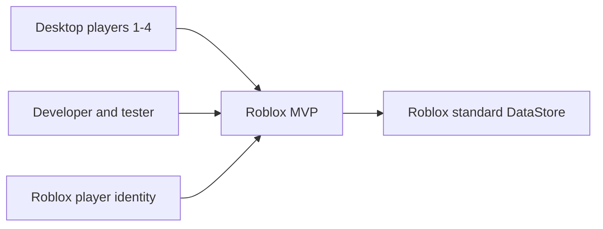

# System Context — v1.0

อ้างอิงข้อยืนยัน/ข้อเปิดใน [PRD](01_PRD_REVIEW.md). MVP desktop1–4คน พัฒนาคนเดียว ลูกเป็นผู้ทดลองแรก

## ผู้เกี่ยวข้อง
| ผู้เกี่ยวข้อง | สิ่งที่ทำ/ต้องการ |
|---|---|
| ผู้เล่น | หาไข่ ฝึก ผสม ลุ้นBuild กลับมาแล้วข้อมูลอยู่ |
| ผู้พัฒนา/ผู้ทดสอบ | ปรับตาราง ตรวจlogs/fault test ไม่ต้องมีadmin UIในเกม |
| Roblox platform | client/server runtime, identity และstandard DataStore |

ขอบเขตเกม: พื้นที่เดียว/8definitions, ไข่ส่วนตัว, TRAINING PvE, เงินในเกม, WorldCondition, profileและrecovery. ไม่มีweb backendหรือpayment serviceเพิ่ม. Day/Night/Rainเป็นเวลาเกม ไม่เชื่อมอากาศจริง

trade/เงินจริง/บอส/PvPไม่อยู่MVP. ผู้ใช้อนุมัติ 2026-10-02 ให้ realtime auto ตามเวลาอิสระทั้งสองฝั่ง และกดสกิลใช้ทันที cooldown เป็นวินาที. สถานะแมตช์ไม่กู้หลังหลุดตามC-30 แต่รายการเศรษฐกิจที่preparedแล้วต้องresolve. Test experienceแยกจากข้อมูลจริง. รูปลักษณ์เมื่อโตยังเปิดO-01; สเปกเครื่องO-02; เกณฑ์ทดลองO-03
