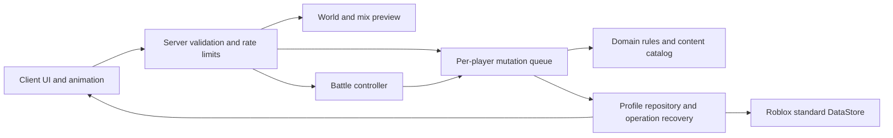
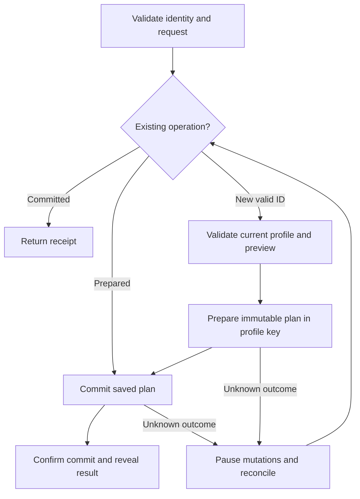

# Architecture — current design baseline

อัปเดตสถานะ 2026-09-12: มี Catalog/DomainRules ผ่าน Studio และเพิ่ม profile/lease/prepare/commit/recovery พร้อม backend จำลองและ test-online adapter แล้ว; online persistence ยังไม่ผ่านการทดสอบจริง ส่วน RPC/battle ยังเป็นแบบออกแบบ ดู [แผนงาน](07_TASKS.md)

อัปเดต2026-09-11 รอบ13. ใช้ D-01–D-25 ใน [Domain Rules](06_DOMAIN_RULES.md) และ [PRD](01_PRD_REVIEW.md) เป็นกฎธุรกิจ; แบบต่อไปนี้เป็นแนวทางที่เลือกสำหรับ MVP ยังไม่ใช่ระบบที่สร้างหรือทดสอบแล้ว

## ขนาดและขอบเขต
เกมเดียวบนRoblox, ผู้พัฒนาคนเดียว, พื้นที่เล็ก, catalog8ตัว, PvE/manual1ต่อ1. Clientรับinput/แสดงUIและanimation; serverคุมกฎ สุ่ม ต่อสู้ และการเปลี่ยนทรัพยากร. ไม่เพิ่มweb backend/SQL/MemoryStore/queue serviceภายนอกในรุ่นนี้

C-28–C-30 ยืนยันคอมพิวเตอร์, ผู้เล่นพร้อมกัน1–4คน, หลุดยกเลิกแมตช์โดยไม่เสียของแล้ว สเปกเครื่องจริงยังไม่ระบุ

## ส่วนประกอบและความรับผิดชอบ
- Content/RuleCatalog: Creature/SkillDefinitions, Base/Jackpot, XP, Economy และWorldWeight แบบversioned; validateก่อนเปิดใช้งาน
- WorldService: derivecycle/phaseจากserverTime+epoch ไม่เพิ่มquotaด้วยการบันทึกทุกวินาที
- MixService: ใช้evaluatorเดียวกันกับpreview/execute เลือกrarityก่อนnormalizeSpecies/Elementแล้วคำนวณSkill/Potential
- BattleController: memory stateของHP/Shield/turn/ownerCooldown; stat snapshotต้นแมตช์, Speedจัดลำดับรอบ, serverเลือกผลคำสั่ง
- Progression/Economy: deriveLevel/PotentialจากXP/ชัยชนะ, จ่ายรางวัลครั้งเดียวและค้างรับไข่เมื่อเต็ม
- PlayerMutationQueue: หนึ่งรายการต่อผู้เล่น, ตรวจlock/battle/capacity/เงินและstateversionก่อนprepare
- ProfileRepository: standardDataStoreหนึ่งkeyต่อผู้เล่น, lease/fencing, durableprepare/commit, receipt/sequence, schema/migrationและrecovery

## Durable mutation flow

CallbackUpdateAsyncไม่มีสุ่ม/network/yield; resultPlanคำนวณครั้งเดียวแล้วตรวจexpectedstateก่อนprepare. จุดยอมรับคือdurableprepare; phaseเปลี่ยนก่อนหน้านั้นให้refreshpreview แต่เปลี่ยนหลังจากนั้นให้ใช้แผนเดิม. Commitเงิน/ตัว/receiptร่วมในkeyเดียว ไม่มีcross-key atomicityที่อ้างเอง

เก็บprofileทุกmutationเศรษฐกิจก่อนsuccess ไม่พึ่งsaveตอนออกเกม. ฟัก3วินาทีเป็นanimationหลังcommit. Timeoutคงpendingและreconcileด้วยbackendstateที่ไม่ใช้cacheเก่า ไม่ใช้GetAsyncที่อาจcachedเป็นข้อพิสูจน์ว่าoperationไม่เกิด

## Concurrency และขอบเขตความเสียหาย
leaseTTL120s/refresh30sเป็นค่าเริ่มทดลอง acquireผ่านUpdateAsyncและเพิ่มgeneration. staleownerถูกfenceทุกwrite; ช่วงbackendขัดข้องหยุดmutationแทนเปิดให้เล่นบนข้อมูลdefault. หลังcrashpreparedถูกกู้ก่อนเปิดprofileให้เล่น

C-30 ยืนยันไม่restoreแมตช์ที่ยังไม่จบ; durableprepared rewardจ่ายต่อได้ ส่วนcrashก่อนprepareไม่รับประกันรางวัลและไม่แสดงsuccessก่อนcommit. หากผู้ใช้ต้องการresumeต้องเพิ่มcheckpointและทบทวนwritebudget

## Trade-offs
หนึ่งprofilekeyทำให้เงิน/ลูก/ไข่และreceiptเปลี่ยนร่วมกันได้และดูแลง่าย แต่เขียนทั้งprofileและจำกัดการขยายtrading. สองphaseรักษาผลสุ่มข้ามcrash แต่ใช้writesมากและเพิ่มlatency. ไม่บันทึกทุกเทิร์นลดภาระ แต่ต้องตกลงC-30เรื่องหลุด

อ่าน/writebudgetตอนruntimeและทำbackoff ไม่ hardcodequotaแพลตฟอร์ม. workloadสมมติ4คน×mutationหนึ่งครั้งทุก10s ใช้48writes/minสำหรับ2phase บวกleaseอย่างมาก8writes/min ก่อนretry/join; เป็นแบบคำนวณวางแผน ไม่ใช่quotaหรือผลbenchmark ต้องตรวจbudgetจริงที่ขนาดผู้ใช้เลือก

## การตรวจและงานที่ยังค้าง
ใช้NFR-01–08ในPRD มีlatency/fault/replay/fencing/profile-size/load checks แต่ยังไม่ได้รัน. แยกtest experienceออกจากข้อมูลจริง. APIcontractsฉบับเต็มและschemaรายละเอียดอยู่ในไฟล์04/05แล้ว; ข้อเปิดปัจจุบันใช้PRD O-01–O-05; ไม่เริ่มimplementationจนผู้ใช้สั่ง

## แหล่งอ้างอิง
ตรวจ2026-09-11: [Roblox Data stores](https://create.roblox.com/docs/cloud-services/data-stores) อธิบายpersistent storageและข้อควรระวังStudio; [GlobalDataStore](https://create.roblox.com/docs/reference/engine/classes/GlobalDataStore) ใช้ตรวจUpdateAsync/callback; [Client-server boundary](https://create.roblox.com/docs/scripting/security/client-server-boundary) ใช้ตรวจservervalidation/rate limiting. การเลือกlease/สองphase/NFRเป็นการออกแบบโปรเจกต์ ไม่ใช่คำรับประกันRoblox

## Contract integration และการทบทวนรอบ13
[Data Model](04_DATA_MODEL.md) และ [API](05_API_SPEC.md) กำหนดtyped profile/operation/battle stateและRemoteEvent envelopes. ไม่มีHTTP serviceเพิ่ม. หนึ่งmutationinflight/profile และไม่รับeconomymutationระหว่างbattleทำให้snapshot/lockไม่แข่งกัน; rewardเป็นinternalcommandหลังจบเท่านั้น

ProfileVersionเพิ่มเมื่อdomaincommit ไม่เพิ่มเมื่อleaseheartbeat เพื่อไม่ทำpreviewstaleโดยไม่จำเป็น. tokenอายุ60sและphaseIdรวมcycle; preparedตรวจเป็นอันดับแรกในretryก่อนexpiry. ขนาดprofileต้องตรวจทั้งผลprepareและผลcommitก่อนรับงาน ไม่ให้ค้างผลที่เขียนไม่ได้

คำสั่งเริ่มimplementationยังเป็น O-05; O-01เกี่ยวกับภาพเติบโต, O-02เครื่องวัดperformance, O-03เกณฑ์playtest ไม่ต้องถามข้อdesktop/ผู้เล่น/หลุดซ้ำเพราะยืนยันแล้ว

การเลือกRemoteEventเป็นtransportอ้าง [Roblox Remote events](https://create.roblox.com/docs/scripting/events/remote) ตรวจ2026-09-11; การกันซ้ำ/commitเป็นหน้าที่operationlayerของโครงการ ไม่ใช่คุณสมบัติdurableของtransport
