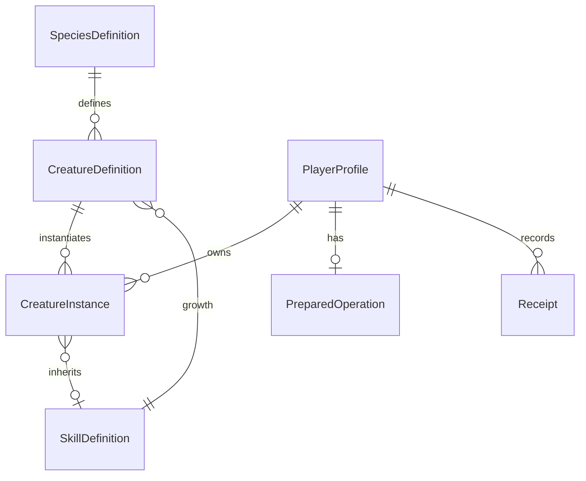

# Data Model — v1.0

อัปเดต 2026-09-12: มี schema v1 และ repository ทดสอบด้วย backend จำลองแล้ว; ยังไม่เชื่อมข้อมูลออนไลน์. กฎและตัวเลขcatalogใช้ [Domain Rules](06_DOMAIN_RULES.md) ส่วนข้อเปิดใช้ [PRD](01_PRD_REVIEW.md)

Implementation I-02 ใช้ `coinDelta`, `eggDelta`, `pendingEggDelta`, `removeIds`, `createCreatures`, `updateCreatures`, `nodeUpdates`, grant flags และ `result` เป็น resultPlan แบบ typed changes; ชื่อจริงและ validation อยู่ใน ProfileSchema. Plan builder เป็น server-only และไม่ใช่ payload ที่รับจาก client

## ประเภทและข้อจำกัดร่วม
IDเป็นstring1–128ตัวอักษรและไม่ยอมรับช่องว่างล้วน; integerต้องfiniteไม่เกิน2^53-1. Timestampเป็นUnix secondsตามserver. Probabilityบนwireเป็นnumber0–1ไม่ใช่เปอร์เซ็นต์และไม่ปัดก่อนสุ่ม. Optional fieldที่ไม่มีค่าให้ละkeyในLuau table ไม่ใช้sentinelปลอม

Creature ID C01–C08 เป็นdefinitionId ไม่ใช่instanceIdของผู้เล่น; instanceIdสร้างserverและไม่ใช้ซ้ำแม้ตัวถูกผสมแล้ว

## Static config — versioned, ไม่เก็บซ้ำทุกprofile
| Entity | Fields / constraints |
|---|---|
| SpeciesDefinition | speciesId: Foxling/Shellkin; potentialType: Might/Guard; speciesSkillId: S01/S02; Vitalityเป็นenumสำรองไม่มีSpeciesใช้ |
| CreatureDefinition | definitionId, displayName, speciesId, element:Fire/Water, rarity:Common/Uncommon/Rare/Epic, baseHP/ATK/DEF/SPD positive integers, growthSkillId |
| SkillDefinition | skillId, compatibility:Species/Element/Universal, allowedSpecies[]หรือallowedElements[], sourceStat:ATK/DEF, multiplier>0, targetDefenseFactor>0, cooldownSeconds=6, shieldFraction0–1 |
| Economy/ProgressionConfig | ราคา/grants/capacities/XPthresholdsตามD-16/D-17 |
| MixingConfig | Base table, rarity probabilities, parent/world weight factors, skillweights, potentialสูตรตามDomain |
| WorldConfig | rulesVersion, epochUnix=0, cycle720, boundaries240/360/600/720 |

Skill/definition referencesต้องมีจริง; SkillCompatibilityต้องสอดคล้องGrowth; BASICเป็นshared actionไม่ใช่สกิลสืบทอด

## PlayerProfile — standard DataStore key `player:<UserId>`
แยกDataStoreของtest/live. mutationภายในหนึ่งkey ไม่มีcross-player transaction

| Field | Type / invariant |
|---|---|
| schemaVersion | integer>=1; เวอร์ชันที่ไม่รองรับหยุดโหลด ไม่ทับdefault |
| profileVersion | monotonic integerเพิ่มทุกcommitted domain mutation; lease refreshไม่เพิ่ม |
| coinBalance | integer>=0 |
| basicEggCount | integer0–20 |
| pendingEggRewards | integer>=0 |
| starterGrantClaimed | boolean;ตั้งร่วมกับให้ของครั้งเดียว |
| firstVictoryEggGranted | boolean;ตั้งเมื่อrewardcommitครั้งแรก ไม่ใช่เมื่อUIแสดง |
| nodeNextAvailableAt | map N01/N02/N03 → timestamp; initialize0ครั้งเดียว |
| creatures | map instanceId→CreatureInstance, count<=30 |
| lease | sessionId, generation>=1, expiresAt; server-only |
| lastAppliedSeq | integer>=0 ใช้กันreplayแม้receiptเก่าถูกล้าง |
| preparedOperation | optional, มีได้หนึ่ง; seq=lastAppliedSeq+1 |
| receipts | ordered listล่าสุดไม่เกิน100; seqและoperationIdไม่ซ้ำ |

default profileยังไม่มีstarterจนgrantcommit. การinitialize/acquireกับstarterต้องใช้idempotent operation; ถ้าprocessตายระหว่างสองขั้น reloadต้องgrantที่ยังไม่เคยรับ ไม่สร้างkeyใหม่ทับ

## CreatureInstance
| Field | Type / rule |
|---|---|
| instanceId | unique server ID ตรงmap key |
| definitionId | C01–C08 |
| totalXP | integer0–480 |
| startingPotentialStars | integer0–5 จากฟัก/ผลผสม |
| winsSinceCreation | integer>=0 |
| inheritedSkillId | optional Universal/Elementที่เข้ากัน ห้ามSpecies |
| isLocked | boolean ป้องกันผสม ไม่ห้ามสู้ |
| createdAt | timestamp |
| originOperationId | IDของรายการที่สร้าง ใช้ตรวจย้อนหลัง |

derive LevelจากXP, stars=min(5,startingPotentialStars+floor(winsSinceCreation/5)), PotentialTypeจากSpecies, Growthจากdefinition/Level5. ไม่เก็บLevel/ดาว/Typeซ้ำเป็นauthoritative values. ระบบประกอบ3slotsขณะอ่าน; สกิลIDซ้ำระหว่างGrowth/Inheritedใช้cooldownเดียวกัน

## OperationPlan และ Receipt
PreparedOperation: operationId, seq, kind, inputFingerprint, expectedProfileVersion, preparedAt, rulesVersion, optional worldPhaseId/parentInstanceVersions, resultPlan. Snapshotต้องเก็บข้อมูลที่พอapplyโดยไม่โหลดกฎรุ่นใหม่ เช่นรายการตัวต้นทาง/ค่าใช้จ่าย/ลูกที่คำนวณแล้ว/ยอดdelta/flags/เวลาจุดไข่

ResultPlanเป็นtyped changes ไม่ใช่callbackหรือโค้ดที่serialize; สำหรับmixมีremoveIds[2], createdCreature[1], coinDelta=-20; hatchมีeggDelta=-1และcreatedCreature; rewardมีcoin/xp/win/grantและไข่หรือpending. Validateผลลัพธ์และprofile projected sizeก่อนprepare

Receipt: operationId, seq, kind, inputFingerprint, committedAt, resultingProfileVersion, resultและoptional compact audit(rules/world/parentIds). ไม่เก็บfullprofileทุกreceipt. เก็บ100ล่าสุด; sequenceเก่าหรือtokenไม่รู้จักไม่ถูกexecuteใหม่. ไม่รับประกันเรียกดูreceiptเกิน100รายการ แต่stateปัจจุบันต้องยังถูกต้อง

## Session-only data
IntentToken: opaque IDผูกplayer/session/action/immutableargs, expiry60s; MixPreviewเพิ่มworldphase/rules/profileVersion. แผนสุ่มไม่ส่งclientก่อนcommit

BattleState: battleId, creatureId, status:active/resolving/ended, revision, startedAt, serverTime, player/enemy snapshots. Fighter: stats/currentHP/shield/shieldExpiresAt/attackInterval/nextAttackAt/skills[{skillId,readyAt,cooldownSeconds}]. Times use server seconds. Battle events contain monotonic seq and at; retain the last 24 for presentation recovery. No round/owner-turn fields. หนึ่งprofileมีactive battleไม่เกิน1.

cachebattleActionผลตามrequestId/revisionระหว่างแมตช์เพื่อกันซ้ำ; disconnectยกเลิกและไม่persistbattle ยกเว้นrewardoperationที่preparedแล้วอยู่ในprofile

## Migration และขนาด
serialized profile<=256KiBเป็นเพดานโครงการ รวมprepared/receipts; ตรวจprojectedหลังcommitด้วยก่อนprepareเพื่อไม่ติดpreparedที่ใหญ่เกิน. หากschema/dataผิดแยกprofileเพื่อตรวจ ไม่ลบข้อมูลอัตโนมัติ. Migration sequential versionบนสำเนาทดสอบก่อน ใช้leaseเดียวกับmutationและไม่เปลี่ยนกฎสุ่มรายการpreparedเดิม. Retention/restoreขั้นดำเนินงานทดสอบใน I-08 ไม่รับประกันmanualrollbackว่าจะรักษาธุรกรรมใหม่โดยอัตโนมัติ
